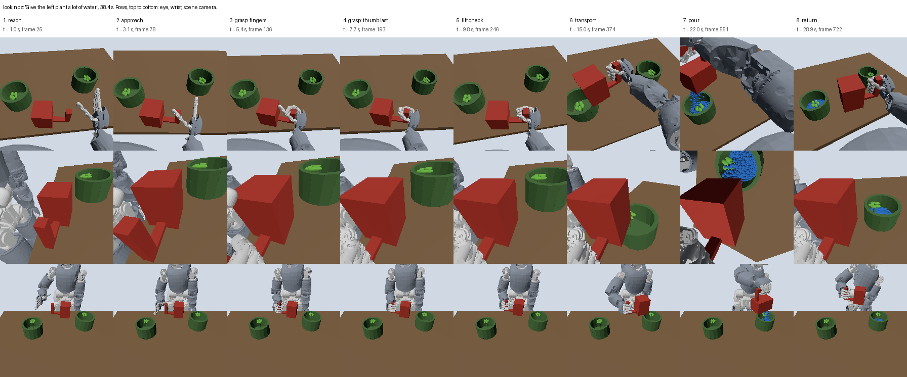

# iCub, the Little Gardener

Robot-learning simulation: the iCub humanoid picks up a watering can with its five-fingered hand and waters plants, with the water simulated as particles. The goal is a pipeline from scripted demonstrations to learned policies, imitation learning (ACT) and a Vision-Language-Action model (SmolVLA), that runs on a 4 GB laptop GPU.

**Stack:** threepp, NVIDIA PhysX, NVIDIA Warp and LeRobot. NVIDIA cuRobo is planned; arm paths currently come from a straight-line IK planner.

## Status (November 2026)

**The scripted expert works, and the first learned policy, ACT + task ID, succeeds on 82% of held-out scenes.**
The expert performs the whole task from an instruction such as "Give the left plant a lot of water": reach,
grasp, lift check, carry, pour, return, place, release and retract. Its 200 recorded demonstrations trained ACT.



| Stage | State |
|---|---|
| iCub in PhysX, with separate finger drives | Done |
| Grasp held by friction only, thumb closing last | Done |
| Particle water in Warp, counted per pot | Done |
| Scripted expert | Done: 50/50 on held-out |
| Wrist camera, real iCub meshes, plants in the pots, spill reporting | Done |
| Dataset of 200 demonstrations in LeRobot format | Done (private on Hugging Face) |
| ACT + task ID | First policy trained: 41/50 on held-out |
| More demonstrations, then retrain ACT | Next |
| SmolVLA | Not started |
| cuRobo motion planning | Not started |

## Results

All in simulation, over randomised scenes. Tuning uses the dev seeds only; the held-out seeds are run once per
final version and never tuned on. Intervals are 95% Wilson intervals.

| | Dev (seeds 0-49) | Held-out (seeds 5000-5049) |
|---|---|---|
| **Scripted expert: success** | 50/50 = 100% (93-100%) | 50/50 = 100% (93-100%) |
| Expert: poured amount in the instruction's band | 50/50 | 50/50 |
| **ACT + task ID (80k steps): success** | 39/50 = 78% (65-87%) | 41/50 = 82% (69-90%) |
| ACT + task ID: poured amount in band, all 50 scenes | 27/50 | 19/50 |
| ACT + task ID: wrong pot | 0/50 | 0/50 |

Success means at least 70% of the poured water lands in the instructed pot, the can ends upright on the table,
nothing but the hand touches anything, and the episode finishes within the time limit.

The policy never picks the wrong plant. Its weak points are aim (7 of its 9 held-out failures are water that
missed the pot) and the amount, worst for "just a little". Changing how often it asks for new actions did not help
(see [docs/results.md](docs/results.md)), so the next step is more demonstrations. Full tables and caveats, such
as policy and expert episodes ending differently, are in [docs/results.md](docs/results.md).

## Known limitations

- **Narrow can layout:** scenes where the can or open hand would meet a pot are redrawn, so most scenes have the can close to iCub. Results don't yet cover the full ±8 cm range. cuRobo is planned to restore it.
- **Time limit:** 45 s rather than the 30 s first planned. Expert episodes take about 43 s.
- **Images:** the can's solid body hides the water level.
- **Water:** the can moves the water, but the water doesn't push back. Its weight is added to the can at the start and stays constant during the pour.
- **Pot contacts:** can-body contacts under 10 N aren't counted, because they can't be told apart from fingers touching the can.

## Setup

Two conda environments, because LeRobot needs different versions of PyTorch and NumPy:

- `gardener` for simulation and recording (`environment.yml`).
- `gardener-train` for LeRobot 0.4.4.

The iCub model comes from [icub-models](https://github.com/robotology/icub-models) and is kept outside this repo. Build the two URDFs with `scripts/make_gardener_urdf.py` and `scripts/fit_hand_colliders.py`.

## Try it

```bash
# In the gardener env
python scripts/run_expert.py --seed 1 --instruction "Water the right plant."   # one episode
python scripts/watch_expert.py --seed 1 --instruction "Water the right plant." # one episode, in a window
python scripts/eval_expert.py --episodes 50 --workers 4                        # evaluate on the dev seeds
python scripts/eval_expert.py --workers 4 --progress data/eval/dev.jsonl       # same, saving each seed as it finishes
python scripts/eval_policy.py CKPT --first-seed 0 --progress data/eval/act_dev.jsonl   # a trained policy on the dev seeds
python scripts/watch_expert.py --seed 1 --instruction "Water the right plant." --policy CKPT   # watch a policy
python scripts/record_episodes.py --count 20 --workers 2                       # record successful episodes
python scripts/test_pour.py --tilt 60                                          # pour test with no robot

# In the gardener-train env, with your ROS PYTHONPATH cleared if you have one
env -u PYTHONPATH python scripts/to_lerobot.py
env -u PYTHONPATH python scripts/check_dataset.py
```

`CKPT` is a checkpoint folder written by training, such as `outputs/act/checkpoints/080000/pretrained_model`.

### Stopping and restarting an evaluation

An evaluation of 50 seeds takes 30-60 minutes. With `--progress FILE.jsonl`, each seed's result is added to that
file the moment the seed finishes, so a stopped run loses only the seeds that were still running.

1. **Stop it** however you like: Ctrl+C, closing the terminal, a shutdown, or the charger watchdog of a run script.
2. **Restart it with exactly the same command.** It prints `resuming: N of 50 seeds already in FILE`, runs only the
   missing seeds, then prints the full report over all 50.

Things to know:
- Saved seeds are reused only when the seed, the instruction and the options all match. So the same file can't mix,
  say, `--n-action-steps 25` with `--n-action-steps 50`: a different setting starts from zero. Still, use one file
  per setting to keep things clear.
- A seed whose episode was killed mid-run is not saved, and runs again on restart.
- To start over on purpose, delete the `.jsonl` file.
- The report itself is still printed only at the end, so keep `| tee report.txt` or `> report.txt` on the command.

The progress log is in [docs/log.md](docs/log.md).
