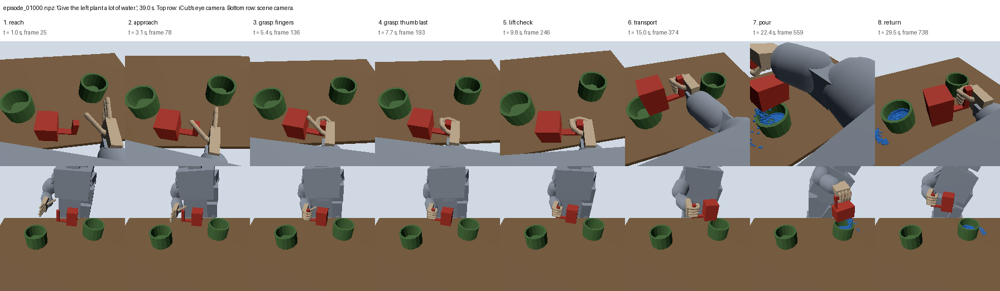

# iCub, the Little Gardener

Robot-learning simulation: the iCub humanoid picks up a watering can with its five-fingered hand and waters plants, with the water simulated as particles. The goal is a pipeline from scripted demonstrations to learned policies, imitation learning (ACT) and a Vision-Language-Action model (SmolVLA), that runs on a 4 GB laptop GPU.

**Stack:** threepp, NVIDIA PhysX, NVIDIA Warp and LeRobot. NVIDIA cuRobo is planned; arm paths currently come from a straight-line IK planner.

## Status (November 2026)

**The scripted expert works, and no policy has been trained yet.** It performs the whole task from an instruction such as "Give the left plant a lot of water": reach, grasp, lift check, carry, pour, return, place, release and retract.



*An early test episode, drawn from the robot's collision shapes, as this build has no visual meshes.*

| Stage | State |
|---|---|
| iCub in PhysX, with separate finger drives | Done |
| Grasp held by friction only, thumb closing last | Done |
| Particle water in Warp, counted per pot | Done |
| Scripted expert | Working, see results below |
| Recording to LeRobot format | Pipeline tested on 20 episodes |
| Wrist camera, plants in the pots, spill reporting | In progress |
| First dataset of 200 episodes | Next |
| ACT and SmolVLA training | Not started |
| cuRobo motion planning | Not started |

## Results

Scripted expert over randomised scenes. Tuning uses the dev seeds only; the held-out seeds are never tuned on.

| | Dev (seeds 0-49) | Held-out (seeds 5000-5049) |
|---|---|---|
| **Success** | 46/50 = 92% (95% interval 81-97%) | 46/50 = 92% (81-97%) |
| Poured amount in the instruction's band | 49/50 | 49/50 |
| Worst drag while grasping | 9.3 mm | 16.1 mm |
| Lowest `wrist_yaw` margin | 7.0° | 5.9° |

Success means at least 70% of the poured water lands in the instructed pot, the can ends upright on the table, nothing but the hand touches anything, and the episode finishes within the time limit.

## Known limitations

- **Narrow can layout:** scenes where the can or open hand would meet a pot are redrawn, so most scenes have the can close to iCub. Results don't yet cover the full ±8 cm range. cuRobo is planned to restore it.
- **Time limit:** 45 s rather than the 30 s first planned. Episodes take about 43 s.
- **Images:** the robot is drawn from collision shapes, and the can's solid body hides the water level.
- **Water:** the can moves the water, but the water doesn't push back. Its weight is added to the can at the start and stays constant during the pour.
- **Pot contacts:** can-body contacts under 10 N aren't counted, because they can't be told apart from fingers touching the can.

## Setup

Two conda environments, because LeRobot needs different versions of PyTorch and NumPy:

- `gardener` for simulation and recording (`environment.yml`).
- `gardener-train` for LeRobot 0.4.4.

The iCub model comes from [icub-models](https://github.com/robotology/icub-models) and is kept outside this repo. Build the two URDFs with `scripts/make_gardener_urdf.py` and `scripts/fit_hand_colliders.py`.

## Try it

```bash
# In the gardener env
python scripts/run_expert.py --seed 1 --instruction "Water the right plant."   # one episode
python scripts/watch_expert.py --seed 1 --instruction "Water the right plant." # one episode, in a window
python scripts/eval_expert.py --episodes 50 --workers 4                        # evaluate on the dev seeds
python scripts/record_episodes.py --count 20 --workers 2                       # record successful episodes
python scripts/test_pour.py --tilt 60                                          # pour test with no robot

# In the gardener-train env, with your ROS PYTHONPATH cleared if you have one
env -u PYTHONPATH python scripts/to_lerobot.py
env -u PYTHONPATH python scripts/check_dataset.py
```

The progress log is in [docs/log.md](docs/log.md).
